# مشخصات و اهداف آزمایش {#sec-info}

* **مؤسسه:** دانشکدگان فنی دانشگاه تهران - دانشکده مهندسی برق و کامپیوتر
* **مدرس:** دکتر بیژن علیزاده
* **دستیاران آموزشی:**
  * عارف قریشی (`ghoreishi.aref@gmail.com` | `@Aref_ghoreishi`)
  * حسین غرابادیان (`hoseingharabadian@gmail.com` | `@hossein_GBDN`)
  * کیمیا فیروزبخش (`Kimiyafiroozbakhsh@gmail.com` | `@Kimia_fbs`)
  * سهیل عبدالهی (`abdollahi.soheil@ut.ac.ir` | `@iwassoheil`)
* **مدت آزمایش:** دو جلسه

### اهداف آزمایش

* آشنایی با معماری، خط لوله و نحوه پیکربندی پردازنده نرم MicroBlaze در بستر FPGA.

* طراحی و پیاده‌سازی سامانه روی تراشه (SoC) در محیط Block Design و ابزار IP Integrator نرم‌افزار Vivado.

* تسلط بر مفاهیم نگاشت حافظه (Memory Map)، گذرگاه ارتباطی <en>AXI4-Lite</en> و تنظیمات پنجره Address Editor.

* توسعه برنامه کاربردی به زبان C در محیط توسعه یکپارچه Vitis و پیاده‌سازی الگوریتم لبه‌یابی Sobel.

* سنجش دقیق زمان اجرای الگوریتم بر حسب سیکل‌های کلاک به کمک ماژول سخت‌افزاری AXI Timer.

* ارسال و دریافت بایت‌های تصویر میان رایانه و بورد سخت‌افزاری از طریق درگاه سریال UART با اسکریپت‌های Python.

---

# مقدمه {#sec-intro}

در این آزمایش، دانشجویان با نحوه راه‌اندازی و یکپارچه‌سازی پردازنده نرم MicroBlaze در محیط Vivado و توسعه برنامه‌های کاربردی سیستم‌های نهفته به زبان C در محیط Vitis آشنا می‌شوند. داده‌های تصویر ورودی در قالب یک فایل Header اختصاصی (`image_data.h`) در حافظه محلی (Local Memory) پردازنده مستقر شده و الگوریتم لبه‌یابی Sobel به صورت نرم‌افزاری اجرا می‌گردد. سپس با استفاده از ماژول سخت‌افزاری AXI Timer، زمان اجرای دقیق برنامه بر حسب سیکل‌های کلاک با بالاترین دقت اندازه‌گیری شده و تصویر فیلترشده از طریق درگاه سریال UART به رایانه ارسال می‌شود تا توسط اسکریپت Python بازسازی و نمایش داده شود. این پیاده‌سازی به عنوان سنگ‌بنا و معیار سنجش کارایی (Benchmark) پایه برای مقایسه با شتاب‌دهنده‌های سخت‌افزاری در آزمایش‌های آتی استفاده خواهد شد.

---

# ۱. مفاهیم پایه و معماری سیستم {#sec-concepts}

## ۱-۱. طراحی هم‌زمان سخت‌افزار و نرم‌افزار (Hardware/Software Co-Design) {#sec-codesign}

در سیستم‌های نهفته مدرن مبتنی بر FPGA، یکی از قدرتمندترین الگوهای طراحی، رویکرد هم‌زمان سخت‌افزار و نرم‌افزار (Hardware/Software Co-Design) است. در این چارچوب، بخش منطق برنامه‌پذیر سخت‌افزاری (Programmable Logic - PL) و بخش پردازشی نرم‌افزاری (Processing System - PS) مکمل یکدیگر عمل می‌کنند. پردازنده MicroBlaze یک پردازنده ۳۲ بیتی نرم (Soft-Core Processor) با معماری RISC هاروارد است که درون بافت منطقی PL سنتز می‌شود و کدهای کامپایل‌شده زبان‌های C/C++ را اجرا می‌نماید. این معماری به مهندسان اجازه می‌دهد وظایف کنترلی، مدیریت درگاه‌ها (Ports) و جریان عمومی برنامه را روی پردازنده مستقر ساخته و بخش‌های محاسباتی فشرده را به واحدهای موازی سخت‌افزاری واگذار نمایند.

## ۲-۱. معماری پردازنده MicroBlaze و حافظه محلی (Local Memory) {#sec-microblaze-arch}

پردازنده MicroBlaze برای نگهداری دستورالعمل‌های برنامه و داده‌های کاری از حافظه محلی (Local Memory) مبتنی بر بلوک‌های حافظه داخلی تراشه (BRAM) استفاده می‌کند. این حافظه اتصال مستقیم و اختصاصی با خطوط کلاک پردازنده داشته و بالاترین سرعت دسترسی با کمترین تأخیر (بدون داوری گذرگاه) را فراهم می‌آورد. این اتصال از طریق دو رابط مستقل برقرار می‌گردد:

* **رابط دستورالعمل (Instruction Local Memory Bus - ILMB):** اختصاصی برای واکشی کدهای اجرایی برنامه با سرعت بالا.

* **رابط داده (Data Local Memory Bus - DLMB):** اختصاصی برای خواندن و نوشتن متغیرها، پشته (Stack) و داده‌های پویا (Heap).

در این آزمایش، داده‌های تصویر ورودی با ابعاد ۱۲۰×۱۶۰ پیکسل در قالب یک فایل Header زبان C (`image_data.h`) در همین حافظه ذخیره می‌شوند. با تنظیم اندازه Local Memory بر روی <en>128 KB</en>، فضای کافی برای استقرار هم‌زمان آرایه تصویر ورودی (<en>19.2 KB</en>)، آرایه خروجی (<en>19.2 KB</en>)، کدهای اجرایی و پشته برنامه فراهم شده و نیازی به کنترلرهای پیچیده حافظه خارجی (نظیر DDR) نخواهد بود.

## ۳-۱. گذرگاه ارتباطی ماژول‌ها (AXI4-Lite) و نگاشت حافظه {#sec-axi}

ارتباط میان پردازنده و واحدهای جانبی (مانند درگاه ارتباط سریال و ماژول زمان‌سنج) از طریق گذرگاه استاندارد صنعتی AXI (Advanced eXtensible Interface) از خانواده پروتکل‌های ARM AMBA صورت می‌پذیرد. در این آزمایش از زیرمجموعه کارآمد این پروتکل با نام <en>AXI4-Lite</en> استفاده می‌شود که برای تبادل داده‌های کنترلی با رجیسترهای ادوات جانبی به صورت نگاشت در حافظه (Memory-Mapped I/O) طراحی شده است. محیط Vivado IP Integrator اتصالات اینترفیس و سوئیچ‌های میان‌جی (AXI Interconnect) را به صورت خودکار پیکربندی می‌نماید. بررسی عمیق‌تر ساختار پیشرفته و انواع دیگر این گذرگاه (نظیر رابط جریانی AXI-Stream و ماژول‌های دسترسی مستقیم DMA) در آزمایش‌های بعدی انجام خواهد گرفت.

## ۴-۱. مبانی و نحوه عملکرد الگوریتم لبه‌یابی Sobel {#sec-sobel}

الگوریتم لبه‌یابی Sobel یک عملگر تفکیک لبه گسسته در پردازش تصویر دوبعدی است که گرادیان تغییرات شدت روشنایی را در هر موقعیت از تصویر محاسبه می‌کند. در این الگوریتم، یک پنجره محاسباتی پیچش دوبعدی (Convolution Mask) با ابعاد ۳×۳ روی تصویر سطح خاکستری ($I$) پیمایش کرده و گرادیان افقی ($G_x$) و عمودی ($G_y$) را مطابق ماتریس‌های وزن‌دار زیر به دست می‌آورد:

$$
G_x = \begin{bmatrix} -1 & 0 & +1 \\ -2 & 0 & +2 \\ -1 & 0 & +1 \end{bmatrix} * I, \quad
G_y = \begin{bmatrix} -1 & -2 & -1 \\ 0 & 0 & 0 \\ +1 & +2 & +1 \end{bmatrix} * I
\tag{۱-۱}
$$

ماتریس $G_x$ لبه‌های عمودی و ماتریس $G_y$ لبه‌های افقی تصویر را استخراج می‌نماید. بزرگی گرادیان کل از تقریب قدرمطلقی استاندارد زیر به دست می‌آید:

$$
G = |G_x| + |G_y|
\tag{۲-۱}
$$

جهت تطبیق دامنه مقادیر خروجی با بازه استاندارد پیکسل‌های ۸ بیتی (۰ تا ۲۵۵)، مجموع گرادیان‌ها بر ۴ تقسیم شده و مقادیر فراتر از ۲۵۵ اشباع (Clamp) می‌گردند:

$$
\text{Pixel}_{\text{out}}(y, x) = \min\left(255, \frac{|G_x| + |G_y|}{4}\right)
\tag{۳-۱}
$$

پیکسل‌های واقع در حاشیه بیرونی تصویر (سطر اول و آخر، و ستون اول و آخر) به سبب عدم وجود همسایگی کامل ۳×۳، با مقدار صفر جایگزین می‌شوند.

## ۵-۱. سنجش دقیق زمان اجرای سخت‌افزاری با ماژول AXI Timer {#sec-axi-timer}

برای ارزیابی کارایی الگوریتم‌های پردازشی در سیستم‌های نهفته، روش‌های نرم‌افزاری مرسوم (مانند توابع زمان‌سنج سیستم‌عامل) دارای خطای ذاتی ناشی از سربار و نوسانات هستند. در این آزمایش از ماژول سخت‌افزاری AXI Timer استفاده می‌شود. این ماژول مستقیماً با فرکانس کلاک سیستم (<en>100 MHz</en>) کلاک‌زنی شده و به عنوان یک زمان‌سنج دقیق ۳۲ بیتی مستقل از پردازنده عمل می‌کند. با فعال‌سازی تایمر پیش از فراخوانی تابع لبه‌یابی و متوقف ساختن آن بلافاصله پس از پایان محاسبات، تعداد دقیق سیکل‌های کلاک پردازنده (Cycles) ثبت شده و زمان اجرای نرم‌افزار بر حسب ثانیه طبق رابطه زیر با دقت نانوثانیه محاسبه می‌گردد:

$$
T_{\text{execution}} = \frac{\text{Cycles}}{f_{\text{clk}}} = \frac{\text{Cycles}}{100 \times 10^6 \text{ Hz}}
\tag{۴-۱}
$$

## ۶-۱. مبانی و ساختار فریم در رابط سریال UART {#sec-uart}

پروتکل ارتباطی UART (Universal Asynchronous Receiver-Transmitter) یک رابط سریال آسنکرون بدون نیاز به خط کلاک مشترک است که ارسال و دریافت بیت‌ها را بر روی دو خط مجزای ارسال (TX) و دریافت (RX) مدیریت می‌کند:

* **نرخ ارسال (Baud Rate):** سرعت تبادل نمادها بر حسب بیت بر ثانیه که در این آزمایش بر روی <en>115200 bps</en> تنظیم می‌گردد.

* **ساختار فریم داده (Frame Format):** در پیکربندی متداول <en>8-N-1</en>، فریم تبادل با یک بیت شروع صفر منطقی (Start Bit) آغاز، به دنبال آن ۸ بیت داده (Data Bits) با اولویت بیت کم‌ارزش (LSB) منتقل شده، و در نهایت با یک بیت پایان یک منطقی (Stop Bit) بدون بیت توازن (No Parity) خاتمه می‌یابد.

---

# ۲. طراحی سخت‌افزار در محیط Vivado {#sec-vivado-hw-design}

در این بخش، پلتفرم سخت‌افزاری مورد نیاز به صورت ماژولار در محیط Block Design نرم‌افزار Vivado پیاده‌سازی می‌شود. هدف از این بخش، راه‌اندازی پردازنده MicroBlaze، تنظیم حافظه داخلی محلی، تولید کلاک ۱۰۰ مگاهرتز، و افزودن کنترلر سریال (AXI UARTLite) و تایمر سخت‌افزاری (AXI Timer) بر روی گذرگاه AXI است.

## ۱-۲. ایجاد پروژه و انتخاب قطعه متناسب با بورد {#sec-create-project}

۱. نرم‌افزار Vivado را اجرا کرده و یک پروژه جدید از نوع RTL Project با نام `LAB2_Sobel` ایجاد نمایید.

<fig id="fig-2-1" caption="شکل ۱-۲: تعیین نام پروژه (LAB2_Sobel) و مسیر ذخیره‌سازی در Vivado">
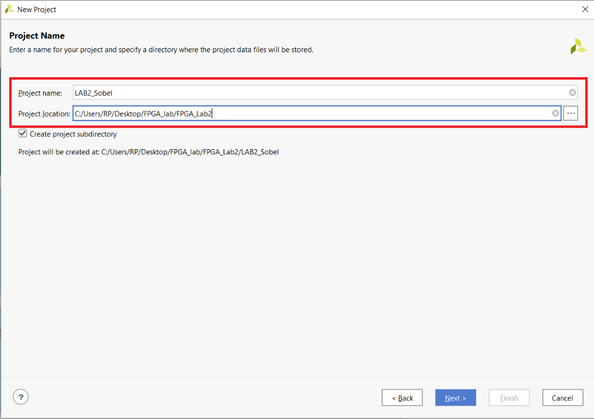
</fig>

۲. نوع پروژه را بر روی RTL Project تنظیم کرده و تیک گزینه **Do not specify sources at this time** را فعال کنید.

<fig id="fig-2-2" caption="شکل ۲-۲: انتخاب ساختار پروژه به صورت RTL Project">
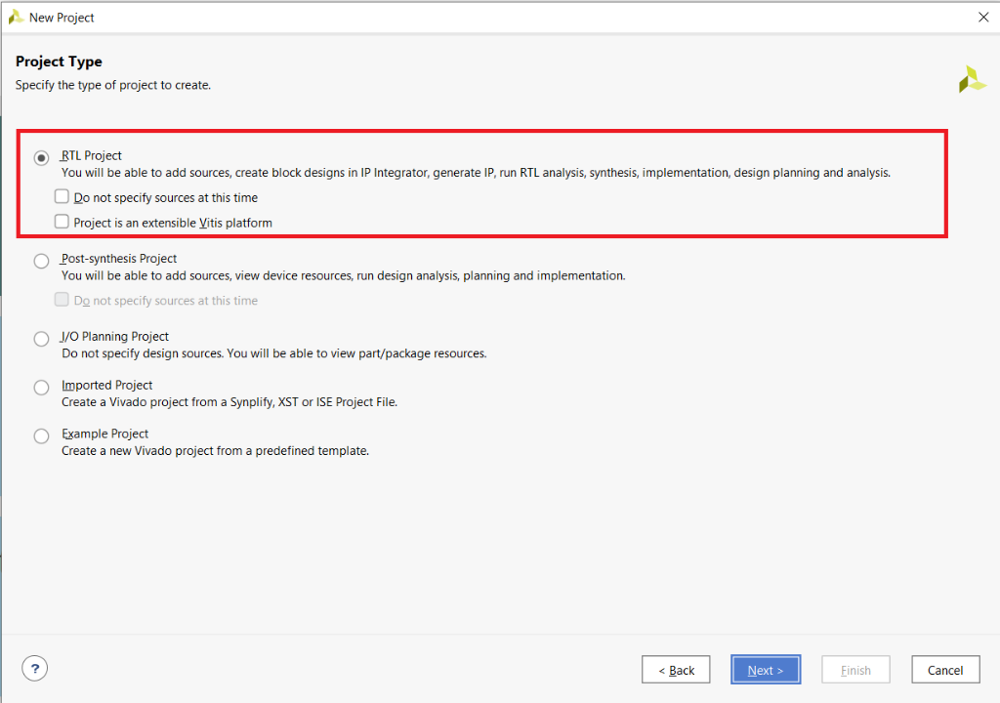
</fig>

۳. در مرحله انتخاب قطعه (Default Part)، متناسب با بورد تحویل‌داده‌شده در آزمایشگاه، شماره قطعه (Part Number) مربوطه را در تب Parts جستجو و انتخاب کنید:

* **بورد Zynq-7020:** شماره قطعه `<en>xc7z020clg400-2</en>`

* **بورد Artix-7 75T:** شماره قطعه `<en>xc7a75tfgg484-2</en>`

* **بورد Artix-7 100T:** شماره قطعه `<en>xc7a100tfgg484-2</en>`

۴. از پنل Flow Navigator گزینه **Create Block Design** را انتخاب کرده و نام آن را `LAB2_sobel` بگذارید.

<fig id="fig-2-3" caption="شکل ۳-۲: ایجاد Block Design با نام LAB2_sobel در محیط IP Integrator">
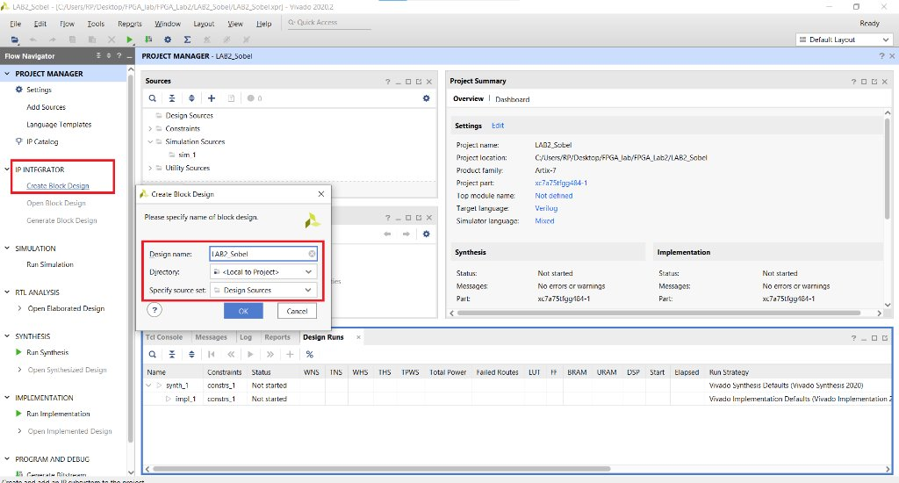
</fig>

## ۲-۲. افزودن و پیکربندی پردازنده MicroBlaze {#sec-add-microblaze}

۱. با کلیک بر روی آیکون (+) **Add IP**، هسته پردازشی MicroBlaze را اضافه کنید. پس از درج، نوار سبز رنگ **Run Block Automation** در بالای پنجره دیاگرام ظاهر می‌شود.

<fig id="fig-2-4" caption="شکل ۴-۲: افزودن پردازنده MicroBlaze به دیاگرام و نمایش نوار خودکارسازی Run Block Automation">
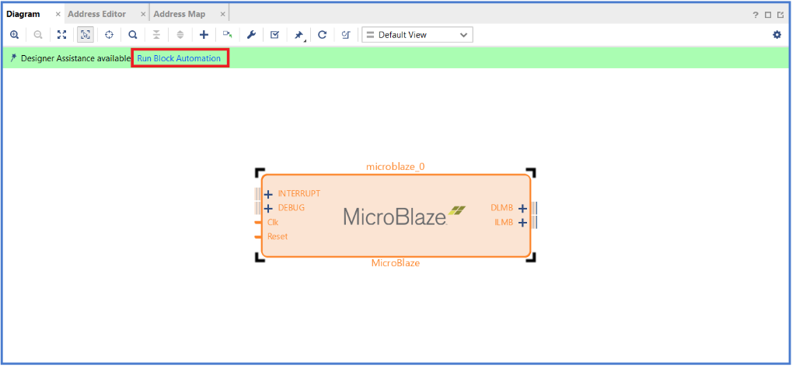
</fig>

۲. بر روی گزینه **Run Block Automation** کلیک نمایید. در پنجره بازشده، اندازه حافظه محلی (Local Memory) را حتماً بر روی <en>128KB</en> تنظیم کنید تا فضای کافی برای کدهای برنامه، آرایه‌های تصویر و پشته سیستم فراهم شود.

<fig id="fig-2-5" caption="شکل ۵-۲: تنظیم اندازه حافظه محلی (Local Memory) برابر با 128 KB در پنجره Run Block Automation">
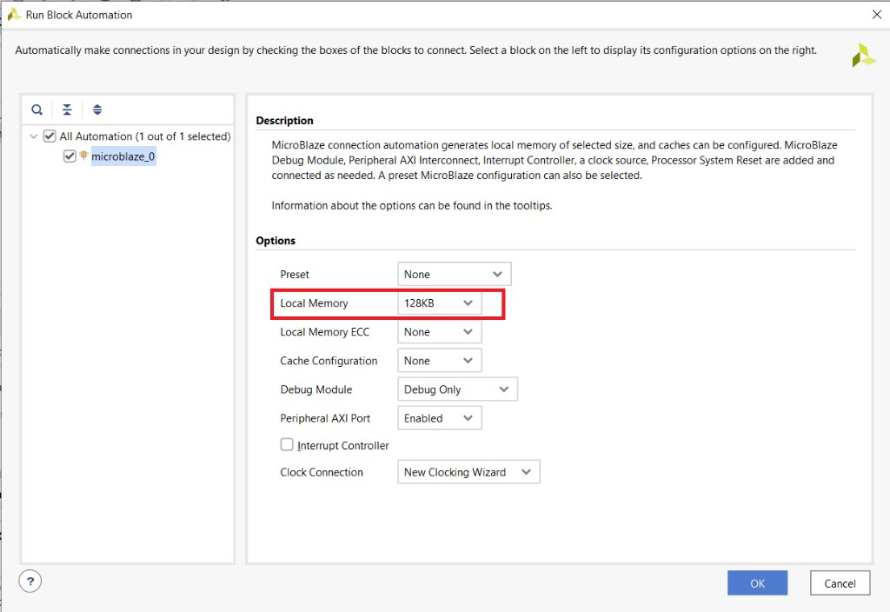
</fig>

## ۳-۲. تنظیم ماژول مدیریت کلاک در Clocking Wizard {#sec-clocking-wizard}

برای تأمین کلاک کاری سنکرون سامانه از ماژول مدیریت کلاک (`clk_wiz_1`) استفاده می‌شود:

۱. بر روی بلوک Clocking Wizard دابل‌کلیک نمایید تا پنجره تنظیمات آن گشوده شود.

۲. در تب Clocking Options، منبع کلاک ورودی (Source) را متناسب با اسیلاتور بورد تنظیم کنید: در بوردهای Artix-7، گزینه **Differential clock capable pin** را انتخاب کرده و فرکانس ورودی را بر روی <en>200 MHz</en> قرار دهید (در صورت استفاده از بورد Zynq-7020، گزینه Single ended clock capable pin با فرکانس ۵۰ مگاهرتز انتخاب شود).

<fig id="fig-2-6" caption="شکل ۶-۲: تنظیم کلاک ورودی تفاضلی (Differential clock) با فرکانس 200 MHz در Clocking Wizard">
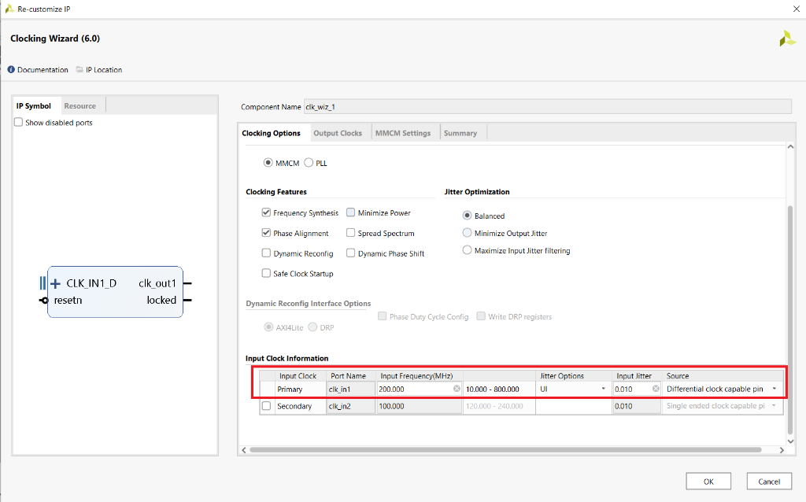
</fig>

۳. در تب Output Clocks، فرکانس خروجی اول (`clk_out1`) را بر روی <en>100 MHz</en> تنظیم نمایید.

<fig id="fig-2-7" caption="شکل ۷-۲: تنظیم فرکانس کلاک خروجی سامانه (clk_out1) بر روی 100 MHz">
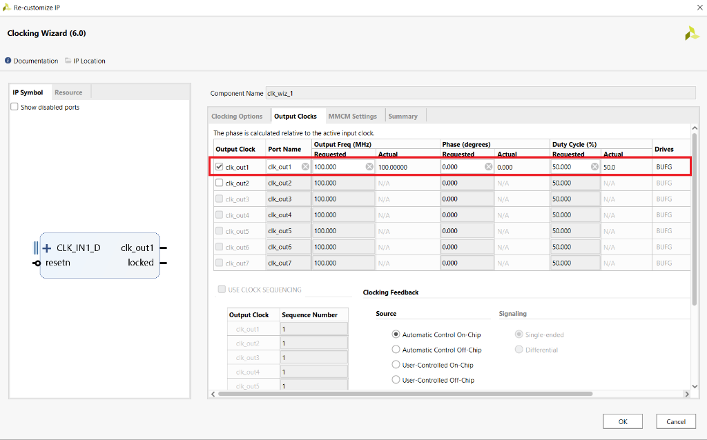
</fig>

۴. در پایین همان تب، نوع سیگنال ریست ورودی را بر روی **Active Low** قرار دهید تا با کلید ریست سخت‌افزاری بورد هماهنگ شود.

<fig id="fig-2-8" caption="شکل ۸-۲: تنظیم نوع سیگنال ریست بر روی Active Low">
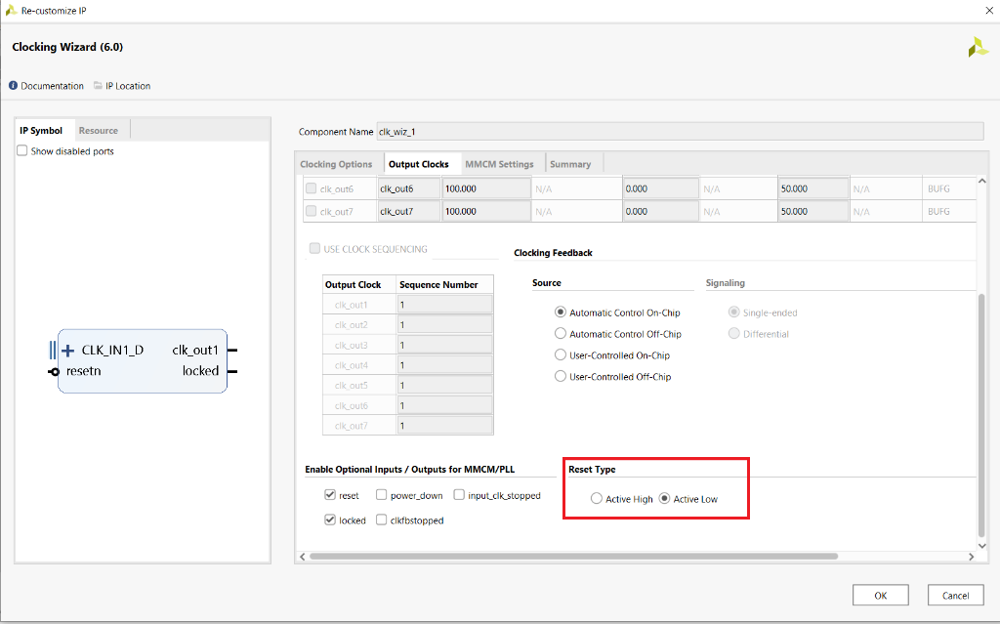
</fig>

## ۴-۲. افزودن ماژول‌های AXI UARTLite و AXI Timer {#sec-uart-timer-ip}

برای ارتباط پردازنده با کامپیوتر به درگاه سریال UART و برای ارزیابی دقیق زمان اجرای الگوریتم بر حسب سیکل کلاک به ماژول سخت‌افزاری AXI Timer نیاز داریم:

۱. ماژول **AXI Uartlite** را از کتابخانه IPها اضافه کرده و در تنظیمات آن، نرخ ارسال داده (Baud Rate) را روی مقدار <en>115200</en> تنظیم کنید.

۲. ماژول **AXI Timer** را به صفحه دیاگرام اضافه نمایید.

۳. بر روی نوار سبز رنگ **Run Connection Automation** کلیک کرده و تمامی اتصالات پیشنهادی برای خطوط کلاک، ریست و گذرگاه‌های AXI را تایید نمایید تا پیاده‌سازی سوئیچ‌های میان‌جی به صورت خودکار کامل شود.

<fig id="fig-2-9" caption="شکل ۹-۲: بلوک دیاگرام کامل سامانه سخت‌افزاری پیاده‌سازی‌شده در محیط Vivado IP Integrator">
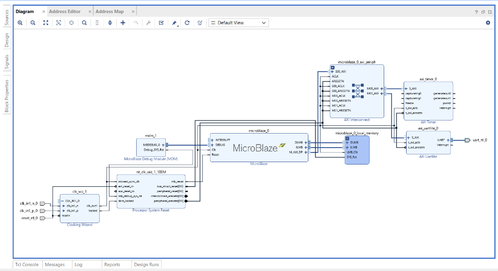
</fig>

## ۵-۲. نگاشت حافظه (Address Editor) و ساخت HDL Wrapper {#sec-address-editor}

در معماری پردازشی مبتنی بر نگاشت حافظه (Memory-Mapped I/O)، هر یک از کنترلرهای جانبی و فضاهای حافظه در یک بازه آدرس‌دهی معین قرار می‌گیرند. نرم‌افزار Vivado آدرس‌های پایه را به صورت خودکار تخصیص می‌دهد. دانشجویان موظف هستند در تب Address Editor طول بازه‌ها (Range) را مطابق جدول ۱-۲ بررسی و کنترل نمایند.

**جدول ۱-۲: جدول نگاشت حافظه (Memory Map) ماژول‌های سامانه در پنجره Address Editor**

| نام ماژول | اینترفیس | آدرس پایه | طول بازه | توضیحات عملکردی |
| :--- | :---: | :---: | :---: | :--- |
| `microblaze_0_local_memory` | ILMB / DLMB | `0x0000_0000` | <en>128 KB</en> | حافظه محلی برای دستورات، داده‌ها و تصویر |
| `axi_uartlite_0` | <en>AXI4-Lite</en> | `0x4060_0000` | <en>64 KB</en> | کنترلر ارتباط سریال UART با سرعت ۱۱۵۲۰۰ |
| `axi_timer_0` | <en>AXI4-Lite</en> | `0x41C0_0000` | <en>64 KB</en> | زمان‌سنج سخت‌افزاری برای شمارش سیکل‌ها |

<fig id="fig-2-10" caption="شکل ۱۰-۲: جدول نگاشت حافظه پردازنده در پنجره Address Editor و طول بازه‌های تخصیص‌یافته">
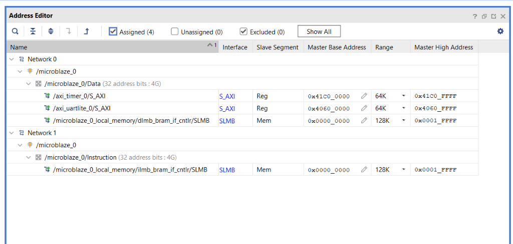
</fig>

پس از کنترل صحت طول آدرس‌ها، دکمه **Validate Design** (کلید میانبر <kbd>F6</kbd>) را فشرده و با راست‌کلیک روی فایل دیاگرام در پنل Sources، گزینه **Create HDL Wrapper** را اجرا کنید (گزینه پیش‌فرض *Let Vivado manage wrapper* انتخاب شود).

## ۶-۲. افزودن فایل قیدها (Constraints) و تخصیص پایه‌ها {#sec-constraints}

فایل قیدهای فیزیکی (`sobel2.xdc`) را به پروژه اضافه نمایید. مشخصات اتصال پایه‌ها مطابق جدول ۲-۲ پیکربندی می‌شود.

**جدول ۲-۲: جدول نمونه تخصیص پایه‌ها روی تراشه بورد آزمایشگاه**

| نام Port | شماره Pin | استاندارد ولتاژ | توضیحات اتصال |
| :--- | :---: | :---: | :--- |
| `clk_in1_p_0` | R4 | DIFF_SSTL135 | پایه مثبت کلاک ورودی ۲۰۰ مگاهرتز اسیلاتور |
| `clk_in1_n_0` | T4 | DIFF_SSTL135 | پایه منفی کلاک ورودی تفاضلی |
| `reset_rtl_0` | R14 | LVCMOS33 | کلید ریست سیستم (فعال پایین، Active-Low) |
| `uart_rtl_0_rxd` | P14 | LVCMOS33 | خط دریافت داده سریال (RX) مبدل USB-UART |
| `uart_rtl_0_txd` | P15 | LVCMOS33 | خط ارسال داده سریال (TX) مبدل USB-UART |

سپس بر روی گزینه **Generate Bitstream** در پنل سمت چپ کلیک نموده تا کلیه مراحل سنتز<fn en="Synthesis"></fn>، جایابی<fn en="Placement"></fn> و سیم‌کشی<fn en="Routing"></fn> سخت‌افزار به صورت خودکار پایان پذیرد.

## ۷-۲. استخراج فایل پلتفرم سخت‌افزاری (Export Hardware) {#sec-export-hardware}

از منوی اصلی `File -> Export -> Export Hardware...` اقدام کرده و در پنجره ظاهرشده حتماً گزینه **Include bitstream** را فعال نمایید تا فایل پیکربندی سخت‌افزاری کامل با نام `LAB2_sobel_wrapper.xsa` در مسیر پروژه ذخیره شود.

<fig id="fig-2-11" caption="شکل ۱۱-۲: گزینه استخراج پلتفرم سخت‌افزاری در منوی نرم‌افزار Vivado">
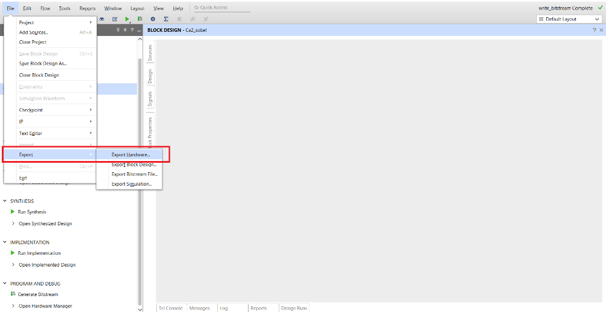
</fig>

<fig id="fig-2-12" caption="شکل ۱۲-۲: پنجره Export Hardware Platform با انتخاب گزینه Include bitstream">
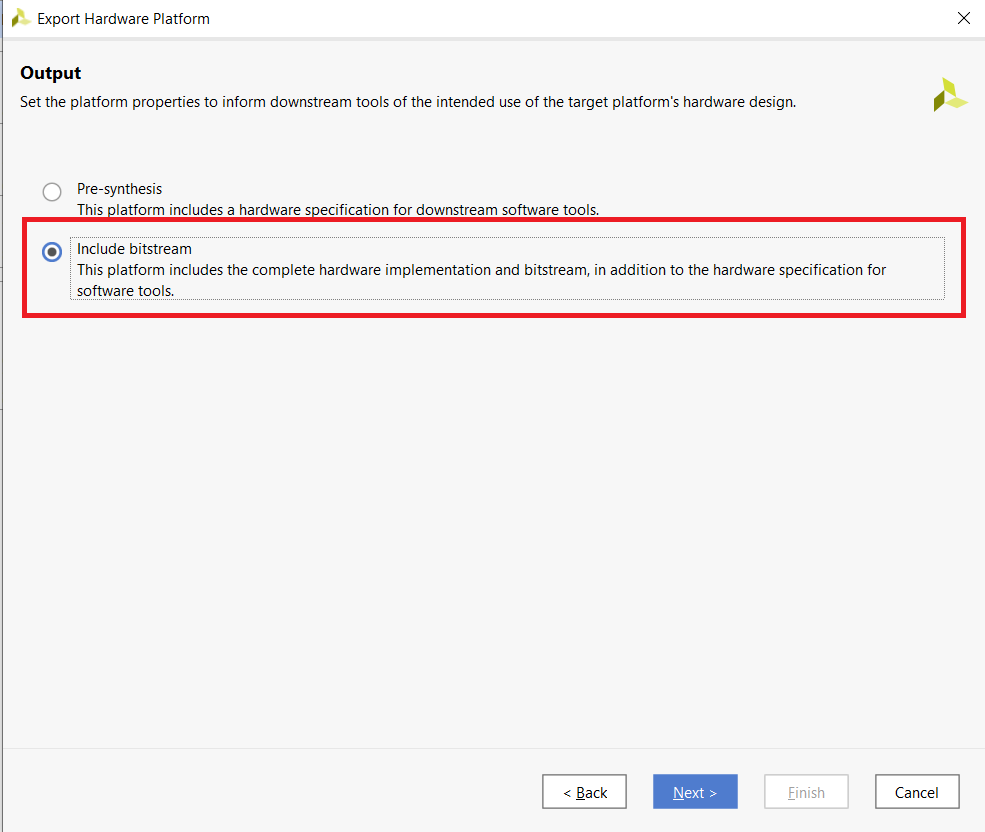
</fig>

---

# ۳. توسعه نرم‌افزار در محیط Vitis و ارتباط با Python {#sec-vitis-sw-dev}

در این بخش، وارد پیاده‌سازی نرم‌افزاری الگوریتم لبه‌یابی و اجرای آن بر روی پردازنده MicroBlaze می‌شویم:

## ۱-۳. راه‌اندازی محیط Vitis و تست پایه با Hello World {#sec-vitis-hello-world}

پیش از آغاز پردازش تصویر، اجرای برنامه پایه Hello World کارکرد صحیح پردازنده، سرعت کلاک و سلامت ارتباط درگاه سریال UART را تضمین می‌کند:

۱. از منوی **Tools** در نرم‌افزار Vivado، گزینه **Launch Vitis IDE** را کلیک کنید.

۲. با انتخاب گزینه **Create Application Project**، فایل پلتفرم استخراج‌شده (`LAB2_sobel_wrapper.xsa`) را بارگذاری نمایید.

۳. نام پروژه را `sobelLAB2app` گذاشته و قالب پیش‌فرض **Hello World** را انتخاب کنید.

۴. بورد را به سیستم متصل نموده و روشن کنید. با تنظیم ترمینال سریال روی سرعت Baud Rate برابر با <en>115200</en>، پروژه را به صورت **Launch Hardware** اجرا کرده و دریافت پیام Hello World را تایید نمایید.

## ۲-۳. تبدیل تصویر ورودی به فایل Header با اسکریپت picture.py {#sec-script-picture}

پردازنده در حالت بدون سیستم‌عامل (Bare-metal) دسترسی به فایل‌سیستم ندارد. بنابراین تصویر ورودی (`input.png`) با ابعاد ۱۲۰×۱۶۰ پیکسل توسط کد Python با نام `picture.py` خوانده شده و به آرایه مقادیر روشنایی سطح خاکستری در فایل Header به نام `image_data.h` تبدیل می‌شود. این فایل را در پوشه `src/` پروژه در Vitis کپی کنید.

<fig id="fig-3-1" caption="شکل ۱-۳: ساختار درختی پروژه در محیط Vitis و قرارگیری فایل‌های برنامه و Header تصویر در پوشه src">
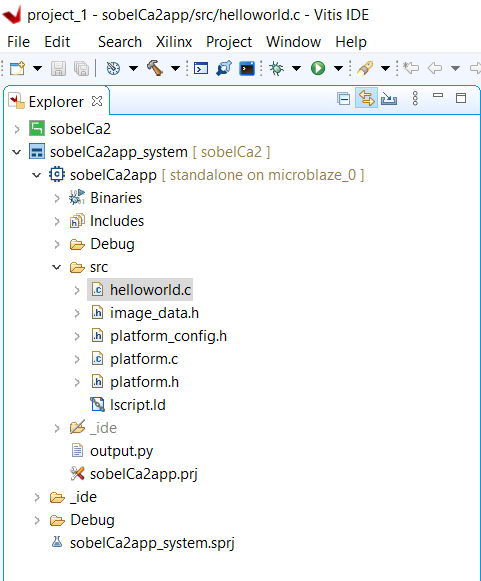
</fig>

## ۳-۳. پیاده‌سازی الگوریتم Sobel، زمان‌سنجی و ارسال سریال در helloworld.c {#sec-impl-sobel}

فایل منبع `helloworld.c` در مسیر `sobelLAB2app/src/` را با کدهای پروژه جایگزین کنید. این برنامه وظایف زیر را انجام می‌دهد:

۱. راه‌اندازی و آغاز شمارش ماژول سخت‌افزاری AXI Timer با دستورات `XTmrCtr_Initialize` و `XTmrCtr_Start`.

۲. ثبت زمان شروع و فراخوانی تابع لبه‌یابی Sobel نرم‌افزاری (`sw_sobel`) بر روی ماتریس پیکسل‌های ورودی.

۳. توقف تایمر بلافاصله پس از محاسبات، استخراج تعداد سیکل‌های کلاک (`sw_cycles = t_end - t_start`) و چاپ آن در ترمینال.

۴. ارسال بایت‌های تصویر لبه‌یابی‌شده از طریق درگاه سریال UART به کامپیوتر در قالب فریم نشانه‌گذاری‌شده با رشته‌های `START_IMAGE` و `END_IMAGE`.

## ۴-۳. دریافت و ذخیره تصویر خروجی با اسکریپت output.py {#sec-script-output}

کد Python با نام `output.py` بر روی کامپیوتر اجرا شده و در انتظار ارسال بایت‌ها از بورد می‌ماند. به محض اجرای برنامه روی پردازنده، بایت‌ها دریافت شده و تصویر نهایی با نام `sobel_output.png` ذخیره و در کنار تصویر اصلی نمایش داده می‌شود.

<fig id="fig-3-2-input" caption="شکل ۲-۳ (الف): تصویر ورودی اصلی (input.png)">

</fig>

<fig id="fig-3-2-output" caption="شکل ۲-۳ (ب): تصویر فیلترشده خروجی Sobel به نام sobel_output.png">

</fig>

---

# ۴. موارد تحویلی گزارش کار و ارزیابی عملکرد (Deliverables) {#sec-deliverables}

هدف از تدوین گزارش کار، مستندسازی دقیق فرآیند مهندسی، تحلیل نتایج کارایی نرم‌افزار و ارزیابی کمی و کیفی لبه‌یابی تصویر بر روی بورد سخت‌افزاری است. علاوه بر تحویل گزارش مکتوب، تسلط بر ساختار کلی سیستم و پاسخ‌گویی به سوالات شفاهی در رابطه با نقش هر یک از اجزای سخت‌افزاری، گذرگاه‌های AXI و زمان‌بندی اجرای نرم‌افزار، ملاک اصلی ارزیابی در جلسه حضوری آزمایشگاه خواهد بود.

دانشجویان محترم موظف هستند در گزارش کار ارسالی موارد زیر را مستند نمایند:

۱. **تسلط و پاسخ‌گویی به سوالات شفاهی بلوک دیاگرام سخت‌افزاری (Block Diagram):** در جلسه ارزیابی حضوری، از تک‌تک اجزای بلوک دیاگرام سخت‌افزاری پیاده‌سازی‌شده (نحوه کار پردازنده MicroBlaze، نقش حافظه محلی BRAM، ماژول مدیریت کلاک Clocking Wizard، کنترلر سریال AXI UARTLite، عملکرد زمان‌سنج سخت‌افزاری AXI Timer و گذرگاه‌های <en>AXI4-Lite</en>) سوال پرسیده خواهد شد.

۲. **تحلیل عملکرد زمانی نرم‌افزار و استخراج معیارهای کارایی:** گزارش دقیق مقدار شمارش‌شده توسط تایمر سخت‌افزاری (`sw_cycles`)، محاسبه زمان اجرای الگوریتم بر حسب میلی‌ثانیه بر اساس فرکانس کلاک ۱۰۰ مگاهرتز، و استخراج نرخ فریم در ثانیه (Frame Rate - FPS):

$$
T_{\text{execution}} = \frac{\text{Cycles}}{100 \times 10^6 \text{ Hz}}, \quad \text{FPS} = \frac{1}{T_{\text{execution}}}
\tag{۱-۴}
$$

۳. **مقایسه کیفی و تحلیل بصری تصاویر:** قرار دادن تصویر ورودی اصلی و تصویر خروجی فیلتر Sobel در گزارش و تحلیل میزان وضوح لبه‌ها، اثر نویز در نواحی یکنواخت، و نحوه مدیریت حاشیه‌های تصویر.

۴. **اسکرین‌شات از خروجی ترمینال و فایل‌های طراحی:** تصویر واضح از خروجی کنسول سریال Vitis شامل مقادیر چاپی سیکل‌ها، تصویر پنجره Address Editor، و فایل‌های کدهای منبع C و اسکریپت‌های پایتون.

---

# ۵. پاسخ به سوالات تحلیلی و تئوری {#sec-questions}

* با توجه به حجم محاسبات هر پیکسل (حداقل ۹ ضرب و جمع برای هر یک از جهت‌های $X$ و $Y$)، چه درصدی از کل زمان اجرا صرف دسترسی به حافظه محلی و چه درصدی صرف عملیات محاسباتی پردازنده می‌شود؟

* انتقال داده‌های تصویر با نرخ <en>115200 bps</en> از طریق درگاه سریال چه مقدار زمان می‌برد و نسبت آن با زمان محاسبات نرم‌افزاری چگونه است؟

* عدم فعال‌سازی واحد ممیز شناور (FPU) و کش (Cache) در پردازنده نرم MicroBlaze چه اثری بر کارایی و زمان اجرای الگوریتم‌های پردازش تصویر دارد؟

---

<mybox type="warning" icon="triangle-exclamation">

### یادداشت‌های تکمیلی و نکات سخت‌افزاری (Hardware Notes)

* **سیم‌بندی ماژول خارجی UART:** در صورتی که از بورد بدون مبدل داخلی USB-UART استفاده می‌کنید، پایه TX ماژول سریال را به پایه RX تعریف‌شده در فایل Constraints و پایه RX را به پایه TX مربوطه متصل نموده و از اتصال مشترک زمین (GND) غافل نشوید.

</mybox>
